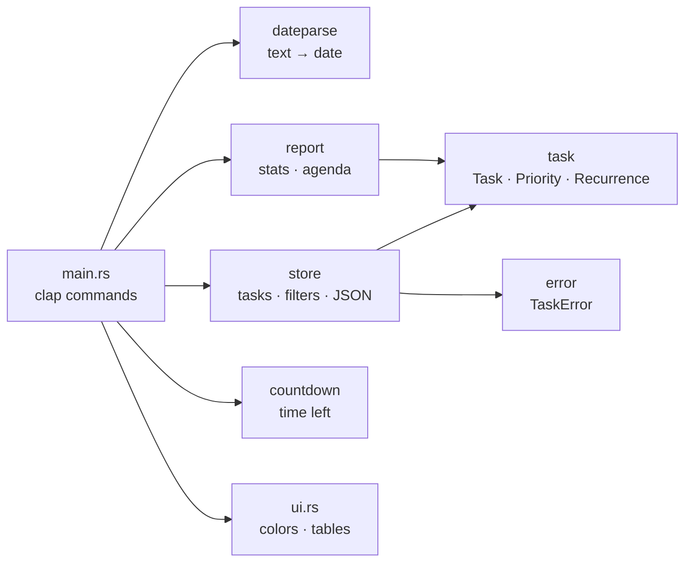

<div align="center">

# ⏳ chrono-tasker

### Never miss a deadline again.
**A fast, colorful command-line task tracker that understands dates like `fri`, `+2w` and `tomorrow`.**

[](https://github.com/swastikjha008-jpg/chrono-tasker/actions/workflows/ci.yml)
[](LICENSE)


### 🧰 Tech Stack


### ✅ Quality


<br/>

[Overview](#-overview) •
[Features](#-features) •
[Quick Start](#-quick-start) •
[Commands](#-commands) •
[How it works](#-how-it-works) •
[Tech Stack](#-tech-stack) •
[Architecture](#-architecture) •
[Testing](#-testing) •
[FAQ](#-faq--troubleshooting)

</div>

---

## 🌟 Overview

**chrono-tasker** is a to-do list built around *time*. Instead of a flat list of chores, every task has a due date, and the tool tells you at a glance what is **overdue**, what is **due today**, and what is **coming up**.

```text
 ID  PRI     DUE              STATUS       REPEAT   TITLE                           TAGS
  2  high    Sun 08 Nov 2026  3d overdue   -        Pay hostel fees                 #college
  3  medium  Wed 11 Nov 2026  due today    -        Push chrono-tasker to GitHub    #rust
  1  high    Fri 13 Nov 2026  in 2d        -        Submit BCA assignment           #college +1
  6  medium  Thu 19 Nov 2026  in 8d        weekly   Water plants                    #home
  5  low     Wed 02 Dec 2026  in 21d       -        Plan Diwali trip
```

Overdue tasks glow **red**, today's are **yellow**, high priority stands out, and finished tasks are dimmed and struck through, all in your terminal.

It is also a **learning project**: a small but complete Rust program that uses real crates, handles errors properly, and is covered by 57 automated tests.

## ✨ Features

| | Feature | Details |
| :-: | --- | --- |
| 📅 | **Natural dates** | `today`, `tomorrow`, `+3d`, `+2w`, `+1m`, `fri`, or `2026-12-25` |
| 🚦 | **Urgency colors** | Overdue, due today, soon (≤ 3 days) and later, each styled differently |
| 🔁 | **Recurring tasks** | Daily, weekly or monthly. Finishing a task schedules the next one |
| ⭐ | **Priorities** | `low`, `medium`, `high`, used for sorting and filtering |
| 🏷️ | **Tags** | Add as many as you like, then filter by tag |
| 🔎 | **Search and filters** | By tag, minimum priority or title text |
| 🗓️ | **Weekly agenda** | Overdue, This week, Next week, then week by week |
| 📊 | **Statistics** | Completion bar, deadline counts, breakdown by priority and tag |
| ⏱️ | **Countdown** | Days, hours and minutes until any date in your local time zone |
| 💾 | **Plain JSON storage** | Human-readable file you own. Easy to back up or sync |
| 🛡️ | **Friendly errors** | Clear messages and a non-zero exit code, safe for scripts |

## ⚡ Quick Start

### 1. Prerequisites

- **Rust 1.85 or newer** from [rustup.rs](https://rustup.rs). Run `rustup update` if unsure.
- **Windows only:** [Build Tools for Visual Studio](https://visualstudio.microsoft.com/visual-cpp-build-tools/) with the **Desktop development with C++** workload. Rust needs Microsoft's linker.

### 2. Get the code

```bash
git clone https://github.com/swastikjha008-jpg/chrono-tasker.git
cd chrono-tasker
```

### 3. Run it

```bash
cargo run -- --help
cargo run -- add "Try chrono-tasker" --due tomorrow
cargo run -- list
```

Everything after `--` goes to the program, not to cargo.

### 4. (Optional) Install it as a command

```bash
cargo install --path .
chrono-tasker list
```

Now you can type `chrono-tasker` from any folder.

## 📖 Commands

| Command | What it does |
| --- | --- |
| [`add`](#add) | Create a task |
| [`list`](#list) | Show pending tasks, soonest first |
| [`done`](#done) | Mark a task finished |
| [`move`](#move) | Change a due date |
| [`remove`](#remove) | Delete a task |
| [`agenda`](#agenda) | Pending tasks grouped by week |
| [`stats`](#stats) | Totals and deadline numbers |
| [`countdown`](#countdown) | Time left until a date |

### `add`

```bash
chrono-tasker add <TITLE> [OPTIONS]
```

| Option | Meaning | Default |
| --- | --- | --- |
| `-d, --due <DATE>` | Due date (see [date formats](#-date-formats)) | `today` |
| `-p, --priority <LEVEL>` | `low`, `medium` or `high` | `medium` |
| `-r, --repeat <RULE>` | `daily`, `weekly` or `monthly` | none |
| `-t, --tag <TAG>` | Add a tag. Repeat the flag for several | none |

```bash
chrono-tasker add "Submit assignment" --due fri --priority high --tag college --tag urgent
chrono-tasker add "Water plants" -d tomorrow -r weekly -t home
```

### `list`

```bash
chrono-tasker list [OPTIONS]
```

| Option | Meaning |
| --- | --- |
| `-a, --all` | Include completed tasks |
| `-t, --tag <TAG>` | Only tasks with this tag |
| `-p, --min-priority <LEVEL>` | Only tasks at or above this priority |
| `-s, --search <TEXT>` | Only tasks whose title contains the text |
| `--plain` | Simple bullet list instead of the table |

```bash
chrono-tasker list --tag college --min-priority medium
chrono-tasker list --search plants --plain
```

Tasks are sorted by due date first, then by highest priority.

### `done`

```bash
chrono-tasker done 1
```

Marks task `1` as finished. If it was recurring, the next round is created for you and printed.

### `move`

```bash
chrono-tasker move 2 +3d
chrono-tasker move 2 2026-12-24
```

### `remove`

```bash
chrono-tasker remove 2
```

### `agenda`

```bash
chrono-tasker agenda
```

```text
Overdue
  • Sun 08 Nov  Pay hostel fees  (#2, high)

This week
  • Wed 11 Nov  Push chrono-tasker to GitHub  (#3, medium)
  • Fri 13 Nov  Submit BCA assignment  (#1, high)

Next week
  • Thu 19 Nov  Water plants  (#6, medium)

Week of 30 Nov 2026
  • Wed 02 Dec  Plan Diwali trip  (#5, low)
```

### `stats`

```bash
chrono-tasker stats
```

```text
Overview
  6 total   1 done   5 pending
  ███░░░░░░░░░░░░░░░░░  17%

Deadlines
  1 overdue   1 due today   1 in the next 7 days

Pending by priority
  high   ▪▪ 2
  medium ▪▪ 2
  low    ▪ 1

Pending by tag
  #college      2
  #home         1
```

### `countdown`

```bash
chrono-tasker countdown 2026-12-25
```

```text
Countdown in 43d 16h 51m (Fri 25 Dec 2026)
```

Past dates show `... ago` instead of `in ...`.

### Global options

| Option | Meaning |
| --- | --- |
| `-f, --file <FILE>` | Where tasks are stored. Default `tasks.json`. Env: `CHRONO_TASKER_FILE` |
| `--today <YYYY-MM-DD>` | Pretend today is another date. Env: `CHRONO_TASKER_TODAY` |
| `-h, --help` | Show help for any command |
| `-V, --version` | Show the version |

## 📅 Date formats

Anywhere a date is expected (`add --due`, `move`, `countdown`), you can type:

| You type | You get |
| --- | --- |
| `today` | The current day |
| `tomorrow` | The next day |
| `+3d` | 3 days from today |
| `+2w` | 2 weeks from today |
| `+1m` | 1 calendar month from today |
| `fri`, `monday` | The next such weekday, always in the future |
| `2026-12-25` | That exact date (`YYYY-MM-DD`) |

## 🧠 How it works

### Urgency

Every pending task is classified by how many days remain:

| Status | Rule | Color |
| --- | --- | --- |
| 🔴 **Overdue** | due date has passed | red, bold |
| 🟡 **Due today** | due today | yellow, bold |
| 🟠 **Soon** | 1 to 3 days away | yellow |
| ⚪ **Later** | 4 or more days away | normal |
| ⚫ **Done** | completed | dimmed, struck through |

### Recurring tasks

When you finish a recurring task, a copy is created with the next due date, counted from the **old due date**:

| Rule | Example |
| --- | --- |
| `daily` | Nov 11 → Nov 12 |
| `weekly` | Nov 11 → Nov 18 |
| `monthly` | Nov 11 → Dec 11 |

Monthly repeats clamp to the end of short months, so **Jan 31 → Feb 28** (or Feb 29 in a leap year).

### Where is my data?

Tasks are stored in `tasks.json` in the folder you run the command from. Point to one shared file with `--file` or an environment variable:

```powershell
# Windows PowerShell
$env:CHRONO_TASKER_FILE = "$HOME\tasks.json"
```

```bash
# macOS / Linux
export CHRONO_TASKER_FILE=~/tasks.json
```

The file is readable and editable by hand:

```json
{
  "next_id": 1,
  "tasks": [
    {
      "id": 1,
      "title": "Water plants",
      "due": "2026-11-12",
      "priority": "medium",
      "recurrence": "weekly",
      "tags": ["home"],
      "created_at": "2026-11-11T07:35:35.203222366Z",
      "completed_at": null
    }
  ]
}
```

`tasks.json` is listed in `.gitignore`, so your personal tasks are never committed. Task ids are never reused, even after you delete a task.

## 🧰 Tech Stack

| Layer | Technology | Why it is used |
| --- | --- | --- |
| Language | [**Rust**](https://www.rust-lang.org/) 2021 edition | Fast, safe, single binary |
| Build tool | [**Cargo**](https://doc.rust-lang.org/cargo/) | Dependencies, building, testing |
| Dates and time | [**chrono**](https://crates.io/crates/chrono) | Dates, time zones, durations, ISO weeks |
| CLI parsing | [**clap**](https://crates.io/crates/clap) (derive) | Subcommands, flags, help text, env vars |
| Serialization | [**serde**](https://crates.io/crates/serde) + [**serde_json**](https://crates.io/crates/serde_json) | Save and load tasks as JSON |
| Errors | [**thiserror**](https://crates.io/crates/thiserror) | A clean custom error type |
| Terminal styling | [**colored**](https://crates.io/crates/colored) | Colors, bold, dim, strikethrough |
| Test helper | [**tempfile**](https://crates.io/crates/tempfile) *(dev only)* | Throwaway folders for tests |
| CI/CD | [**GitHub Actions**](https://github.com/features/actions) | Format, lint and test on every push |
| Linting | `rustfmt` + `clippy` | Consistent, warning-free code |

## 🏗️ Architecture



```text
chrono-tasker/
├── .github/workflows/ci.yml   # fmt + clippy + tests on Linux / macOS / Windows
├── src/
│   ├── main.rs                # CLI definition and command handlers
│   ├── ui.rs                  # colored tables, bars and progress output
│   ├── lib.rs                 # library entry point
│   ├── task.rs                # Task, Priority, Recurrence, Urgency, Summarize
│   ├── dateparse.rs           # "fri", "+2w", "2026-12-25" → date
│   ├── store.rs               # task list, filters, JSON load/save
│   ├── report.rs              # statistics and weekly agenda
│   ├── countdown.rs           # time until a date, generic over time zones
│   └── error.rs               # TaskError with thiserror
├── tests/
│   └── cli.rs                 # end-to-end tests of the real binary
├── Cargo.toml
├── Cargo.lock
├── LICENSE
└── README.md
```

**Design choices**

- **Library + thin binary.** All logic lives in the library, so it is easy to test and reuse.
- **No hidden clock.** Functions take `today` as a parameter instead of reading the time, so tests give the same result every day.
- **Presentation is separate.** Colors and tables live only in `ui.rs`, never in the core logic.

## 📚 Rust concepts demonstrated

| Concept | Where to look |
| --- | --- |
| Enums with data and pattern matching with guards | `Urgency` in `task.rs` |
| Traits with default methods | `Summarize` in `task.rs` |
| Implementing `Display` and `FromStr` | `Priority`, `Recurrence` in `task.rs` |
| Builder pattern and generic `where` bounds | `NewTask` in `task.rs` |
| Lifetimes on structs | `TaskFilter<'a>` in `store.rs`, `Section<'a>` in `report.rs` |
| Struct update syntax (`..other`) | `Store::complete`, `Stats::compute` |
| Closures, iterator chains, `sort_by_key` | `Store::select` |
| `Result`, `?`, `map_err`, custom errors | `error.rs`, `Store::load` |
| `Option` combinators | `store.rs`, `report.rs` |
| `BTreeMap` and the entry API | `Stats::compute`, `build_agenda` |
| Slice patterns (`[first, rest @ ..]`) | `tag_list` in `ui.rs` |
| Generics over time zones (`T: TimeZone`) | `time_until` in `countdown.rs` |
| Generic functions over iterators | `bullet_list` in `report.rs` |
| Modules, visibility, lib + bin split | `lib.rs`, `main.rs` |
| Associated constants | `Priority::ALL` |
| Conditional compilation (`#[cfg(windows)]`) | `main.rs` |
| Unit, doc and integration tests | everywhere |

## 🧪 Testing

```bash
cargo test
```

| Layer | Count | Where |
| --- | :---: | --- |
| Library unit tests | 35 | `src/*.rs` |
| Binary unit tests | 3 | `src/ui.rs` |
| End-to-end CLI tests | 13 | `tests/cli.rs` |
| Doc tests | 6 | examples in doc comments |

The end-to-end tests run the real compiled binary against a temporary file, with "today" pinned to a fixed date.

Run the same checks as CI before committing:

```bash
cargo fmt --all -- --check
cargo clippy --all-targets -- -D warnings
cargo test
```

## ❓ FAQ & Troubleshooting

<details>
<summary><b>error: linker <code>link.exe</code> not found (Windows)</b></summary>

Install [Build Tools for Visual Studio](https://visualstudio.microsoft.com/visual-cpp-build-tools/) with the **Desktop development with C++** workload, then fully restart your terminal or editor.
</details>

<details>
<summary><b>The build fails with a version or "unstable feature" error</b></summary>

Your Rust is too old. Run `rustup update`. This project needs Rust 1.85 or newer.
</details>

<details>
<summary><b>Where did my tasks go?</b></summary>

Tasks are saved in `tasks.json` in the folder you ran the command from. Running from a different folder uses a different file. Use `--file` or `CHRONO_TASKER_FILE` to always use the same one.
</details>

<details>
<summary><b>Colors look broken or show strange symbols</b></summary>

Use Windows Terminal, the VS Code terminal or a recent PowerShell. To turn colors off, set `NO_COLOR=1`.
</details>

<details>
<summary><b>How do I try it with a fake date?</b></summary>

```bash
chrono-tasker --today 2026-12-01 list
```
</details>

## 🤝 Contributing

Contributions, issues and ideas are welcome.

1. Fork the repo and create a branch: `git checkout -b feature/my-idea`
2. Make your change and run the checks above
3. Commit and open a pull request

## 📄 License

Released under the [MIT License](LICENSE).

---

<div align="center">

Built with 🦀 by [**@swastikjha008-jpg**](https://github.com/swastikjha008-jpg)

If this helped you learn Rust, a ⭐ is appreciated.

</div>
