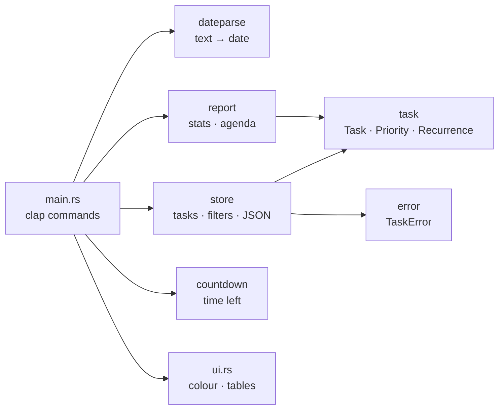

<div align="center">

# ⏳ chrono-tasker

**A colorful command-line deadline tracker, built with Rust and [chrono](https://crates.io/crates/chrono).**

[](https://github.com/swastikjha008-jpg/chrono-tasker/actions/workflows/ci.yml)
[](https://www.rust-lang.org/)
[](LICENSE)


[Features](#-features) •
[Quick Start](#-quick-start) •
[Usage](#-usage) •
[Architecture](#-architecture) •
[Rust concepts](#-rust-concepts-demonstrated) •
[Testing](#-testing)

</div>

---

## ✨ About

`chrono-tasker` keeps track of what is due and when. Add tasks with natural dates like `fri` or `+2w`, see what is overdue, get a week-by-week agenda, and let recurring tasks reschedule themselves when you finish them. Everything is stored in a plain JSON file you own.

It is also a **learning project**: a small, real program that puts third-party crates and a broad slice of Rust syntax to work, with every module covered by tests.

## 🚀 Features

- 📅 **Natural dates** — `today`, `tomorrow`, `+3d`, `+2w`, `+1m`, `fri`, or `2026-12-25`
- 🚦 **Urgency at a glance** — overdue, due today, soon and later, colour-coded
- 🔁 **Recurring tasks** — daily, weekly or monthly; finishing one creates the next
- 🏷️ **Tags, priorities and search** — filter by tag, minimum priority or text
- 🗓️ **Weekly agenda** — grouped into Overdue, This week, Next week and later
- 📊 **Stats** — completion bar, deadlines and counts by priority and tag
- ⏱️ **Countdown** — days, hours and minutes until any date, in your local time zone
- 💾 **Plain JSON storage** — human-readable, easy to back up or sync

## ⚡ Quick Start

### Prerequisites

- [Rust](https://rustup.rs) 1.85 or newer (`rustup update` if unsure)
- **Windows only:** [Build Tools for Visual Studio](https://visualstudio.microsoft.com/visual-cpp-build-tools/) with the **Desktop development with C++** workload

### Run it

```bash
git clone https://github.com/swastikjha008-jpg/chrono-tasker.git
cd chrono-tasker
cargo run -- --help
```

### Install it as a command

```bash
cargo install --path .
chrono-tasker add "Try chrono-tasker" --due tomorrow
```

## 📖 Usage

```text
Commands:
  add        Add a task
  list       List pending tasks, soonest first
  done       Mark a task as done (recurring tasks schedule their next round)
  remove     Delete a task
  move       Change a task's due date
  agenda     Show pending tasks grouped by week
  stats      Show totals and deadline statistics
  countdown  Count down to a date

Options:
  -f, --file <FILE>   JSON file that stores your tasks [default: tasks.json]
      --today <DATE>  Pretend today is this date (YYYY-MM-DD); handy for testing
```

### Examples

```bash
# Add tasks
cargo run -- add "Submit assignment" --due fri --priority high --tag college
cargo run -- add "Water plants" --due tomorrow --repeat weekly --tag home

# See them
cargo run -- list
cargo run -- list --tag college --min-priority medium
cargo run -- list --search plants --plain
cargo run -- agenda
cargo run -- stats

# Update them
cargo run -- done 1
cargo run -- move 2 +3d
cargo run -- remove 2

# Time left
cargo run -- countdown 2026-12-25
```

### Sample output

```text
 ID  PRI     DUE              STATUS       REPEAT   TITLE                           TAGS
  2  high    Sun 08 Nov 2026  3d overdue   -        Pay hostel fees                 #college
  3  medium  Wed 11 Nov 2026  due today    -        Push chrono-tasker to GitHub    #rust
  1  high    Fri 13 Nov 2026  in 2d        -        Submit BCA assignment           #college +1
  6  medium  Thu 19 Nov 2026  in 8d        weekly   Water plants                    #home
  5  low     Wed 02 Dec 2026  in 21d       -        Plan Diwali trip

5 task(s)
```

```text
Overdue
  • Sun 08 Nov  Pay hostel fees  (#2, high)

This week
  • Wed 11 Nov  Push chrono-tasker to GitHub  (#3, medium)
  • Fri 13 Nov  Submit BCA assignment  (#1, high)

Next week
  • Thu 19 Nov  Water plants  (#6, medium)
```

### Where is my data?

Tasks live in `tasks.json` in the folder you run the command from. Use `--file ~/tasks.json` or set the `CHRONO_TASKER_FILE` environment variable to keep one list everywhere. The file is in `.gitignore`, so your personal tasks never get committed.

### Date formats

| Input | Meaning |
| --- | --- |
| `today`, `tomorrow` | The current day, the next day |
| `+3d`, `+2w`, `+1m` | Days, weeks or calendar months from today |
| `fri`, `monday` | The next such weekday, strictly after today |
| `2026-12-25` | An exact ISO date |

Monthly repeats clamp to the end of short months, so Jan 31 becomes Feb 28 (or 29 in a leap year).

## 🏗️ Architecture



```text
chrono-tasker/
├── .github/workflows/ci.yml   # fmt + clippy + tests on Linux / macOS / Windows
├── src/
│   ├── main.rs                # CLI definition and command handlers
│   ├── ui.rs                  # coloured tables, bars and progress output
│   ├── lib.rs                 # library entry point
│   ├── task.rs                # Task, Priority, Recurrence, Urgency, Summarize
│   ├── dateparse.rs           # "fri", "+2w", "2026-12-25" → NaiveDate
│   ├── store.rs               # task list, filters, JSON load/save
│   ├── report.rs              # statistics and weekly agenda
│   ├── countdown.rs           # time until a date, generic over time zones
│   └── error.rs               # TaskError with thiserror
├── tests/
│   └── cli.rs                 # end-to-end tests of the real binary
├── Cargo.toml
├── Cargo.lock
├── LICENSE
└── README.md
```

The logic lives in a **library** and `main.rs` stays thin. Time-dependent functions take `today` as a parameter instead of reading the clock, so tests are deterministic.

## 📦 Crates used

| Crate | Used for |
| --- | --- |
| [`chrono`](https://crates.io/crates/chrono) | Dates, time zones, durations, ISO weeks |
| [`clap`](https://crates.io/crates/clap) | Command-line parsing with derive macros |
| [`serde`](https://crates.io/crates/serde) + [`serde_json`](https://crates.io/crates/serde_json) | Saving and loading tasks as JSON |
| [`thiserror`](https://crates.io/crates/thiserror) | A clean custom error type |
| [`colored`](https://crates.io/crates/colored) | Terminal colours |
| [`tempfile`](https://crates.io/crates/tempfile) *(dev)* | Throwaway folders for tests |

## 📚 Rust concepts demonstrated

| Concept | Where to look |
| --- | --- |
| Enums with data and pattern matching with guards | `Urgency` in `task.rs` |
| Traits with default methods | `Summarize` in `task.rs` |
| Implementing `Display` and `FromStr` | `Priority`, `Recurrence` in `task.rs` |
| Builder pattern and generic `where` bounds | `NewTask` in `task.rs` |
| Lifetimes on structs | `TaskFilter<'a>` in `store.rs`, `Section<'a>` in `report.rs` |
| Struct update syntax (`..other`) | `Store::complete`, `Stats::compute` |
| Closures, iterator chains, `sort_by_key` | `Store::select` |
| `Result`, `?`, `map_err`, custom errors | `error.rs`, `Store::load` |
| `Option` combinators (`is_none_or`, `map_or_else`, `ok_or`) | `store.rs`, `report.rs` |
| `BTreeMap` and the entry API | `Stats::compute`, `build_agenda` |
| Slice patterns (`[first, rest @ ..]`) | `tag_list` in `ui.rs` |
| Generics over time zones (`T: TimeZone`) | `time_until` in `countdown.rs` |
| Generic functions over iterators | `bullet_list` in `report.rs` |
| Modules, visibility and a lib + bin split | `lib.rs`, `main.rs` |
| Associated constants | `Priority::ALL` |
| `#[cfg(windows)]` conditional compilation | `main.rs` |
| Unit, doc and integration tests | everywhere |

## 🧪 Testing

```bash
cargo test
```

| Layer | Count | Where |
| --- | :---: | --- |
| Library unit tests | 35 | `src/*.rs` |
| Binary unit tests | 3 | `src/ui.rs` |
| End-to-end CLI tests | 13 | `tests/cli.rs` |
| Doc tests | 6 | examples in doc comments |

Run the same checks as CI before committing:

```bash
cargo fmt --all -- --check
cargo clippy --all-targets -- -D warnings
cargo test
```

## 🤝 Contributing

Contributions, issues and ideas are welcome.

1. Fork the repo and create a branch: `git checkout -b feature/my-idea`
2. Make your change and run the checks above
3. Commit and open a pull request

## 📄 License

Released under the [MIT License](LICENSE).

---

<div align="center">

Built with 🦀 by [**@swastikjha008-jpg**](https://github.com/swastikjha008-jpg)

If this helped you learn Rust, a ⭐ is appreciated.

</div>
